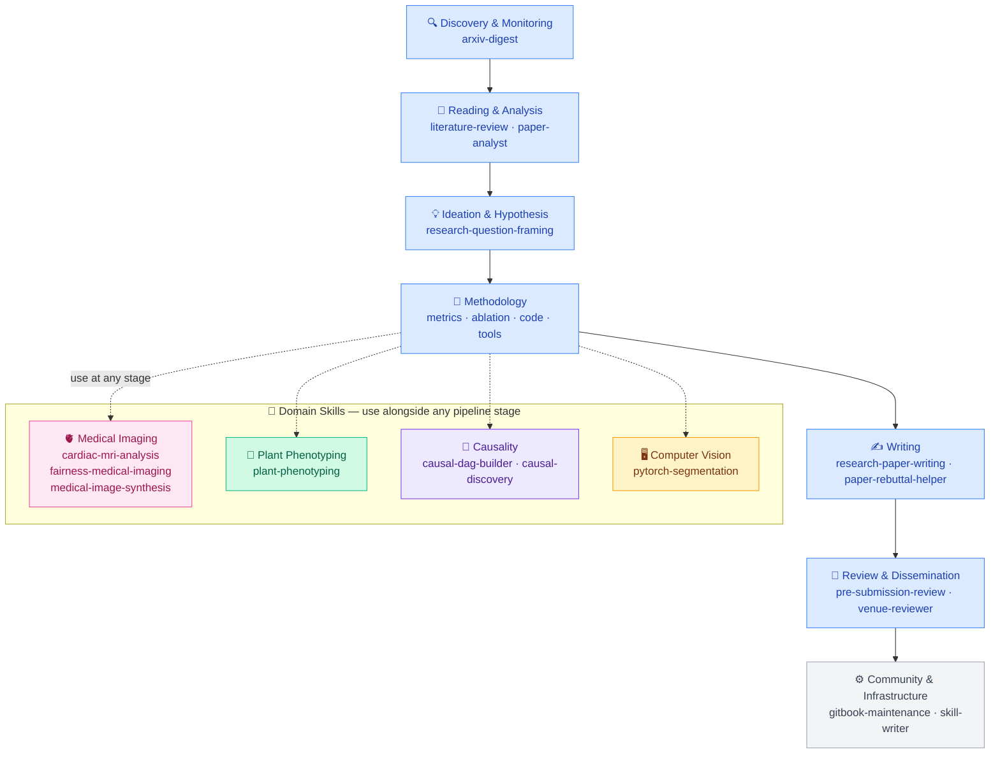

# Vios Research Skills

A curated library of [Agent Skills](https://github.com/vercel-labs/ai-sdk-preview-agent-skills) for AI, causality, and medical-imaging research — maintained by the [VIOS Lab](https://vios.science/) at the University of Edinburgh.

Each skill is a self-contained `SKILL.md` that any Agent-Skills-compatible client — **Claude Code, Cursor, Codex, Gemini CLI** — can install and invoke automatically when you describe a matching task.



---

## Quick start

```bash
npx skills add vios-s/Vios-Research-Skills
```

That's it. The skills drop into `~/.agents/skills/` and your AI agent starts using them on the next session.

---

## Auto-update (recommended)

Run once to keep skills current every time you start Claude Code:

**macOS / Linux**
```bash
bash <(curl -fsSL https://raw.githubusercontent.com/vios-s/Vios-Research-Skills/main/install/setup.sh)
```

**Windows (PowerShell)**
```powershell
irm https://raw.githubusercontent.com/vios-s/Vios-Research-Skills/main/install/setup.ps1 | iex
```

Both scripts install the skills and register a Claude Code `SessionStart` hook that runs `npx skills update --yes` silently in the background on every session. The hook uses a cross-platform Node.js call — no shell differences between macOS, Linux, and Windows.

To configure the hook manually, copy [`install/claude-code-hook.json`](./install/claude-code-hook.json) into your `~/.claude/settings.json`.

---

## What's included

| Category | Skills |
|----------|--------|
| **Discovery & Monitoring** | `arxiv-digest` |
| **Reading & Analysis** | `literature-review`, `paper-analyst` |
| **Ideation & Hypothesis** | `research-question-framing` |
| **Domain: Medical Imaging** | `cardiac-mri-analysis`, `fairness-medical-imaging`, `medical-image-synthesis` |
| **Domain: Plant Phenotyping** | `plant-phenotyping` |
| **Domain: Causality** | `causal-dag-builder`, `causal-discovery` |
| **Domain: Computer Vision** | `pytorch-segmentation` |
| **Writing** | `research-paper-writing`, `paper-rebuttal-helper` |
| **Review & Dissemination** | `pre-submission-review`, `venue-reviewer` |
| **Community & Infrastructure** | `gitbook-maintenance`, `skill-writer` |

Browse human-readable previews on [GitBook](https://app.gitbook.com/o/iKj8iQxX5VVQz0YId3W8/s/JrUZyt5iYQfdGE1vmZnd/) — the same Markdown your agent reads, rendered for humans.

---

## How skills work

A skill fires when your AI agent matches your request against the skill's `description` field. For example:

> *"My segmentation model has a big performance gap between male and female patients"*
> → agent invokes `fairness-medical-imaging`

> *"Write a rebuttal to Reviewer 2 who says our method lacks novelty"*
> → agent invokes `paper-rebuttal-helper`

You never call a skill explicitly — the agent picks the right one from context.

---

## Contribute

Lab members can edit existing skill content directly via [GitBook](https://app.gitbook.com/o/iKj8iQxX5VVQz0YId3W8/s/JrUZyt5iYQfdGE1vmZnd/) (changes sync to GitHub automatically), or open a PR for new skills.

See [`CONTRIBUTING.md`](./CONTRIBUTING.md) for the `SKILL.md` template, frontmatter rules, and CI checks.

Want to build a private fork with internal skills? See [`FORKING.md`](./FORKING.md).

---

## License

MIT — see [`LICENSE`](./LICENSE). Individual skills may carry their own license; check each skill's frontmatter.
