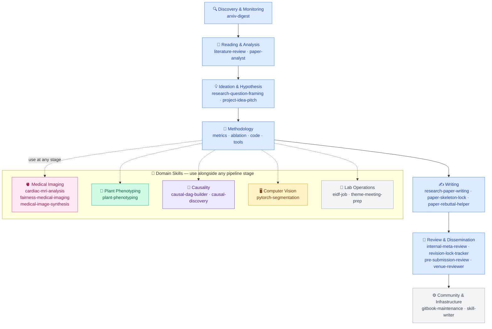

# Vios Research Skills

A curated library of [Agent Skills](https://agentskills.io/) for AI, causality, and medical-imaging research — maintained by the [VIOS Lab](https://vios.science/) at the University of Edinburgh.

Each skill is a self-contained `SKILL.md` that any Agent-Skills-compatible client — **Claude Code, Codex, Gemini CLI, Cursor, GitHub Copilot, OpenCode** — can install and invoke automatically when you describe a matching task.



---

## Install

Pick **one** route per client. Installing the same skills twice (e.g. as a plugin *and* with `npx skills`) makes the client list every skill twice.

### Claude Code — plugin (recommended)

In Claude Code:

```
/plugin marketplace add vios-s/Vios-Research-Skills
/plugin install vios-research-skills@vios-research-skills
```

Skills appear as `/vios-research-skills:<skill>` and also fire automatically. Turn on auto-update for the marketplace in `/plugin` → Marketplaces to receive new skills.

### Gemini CLI — extension

```bash
gemini extensions install https://github.com/vios-s/Vios-Research-Skills --auto-update
```

### Any Agent Skills client — `skills` CLI

Works for Codex, Antigravity CLI, Cursor, GitHub Copilot, OpenCode, and also Claude Code and Gemini CLI. Needs **Node.js 22.20 or newer**.

```bash
npx skills add vios-s/Vios-Research-Skills -g
```

`-g` installs for your user; without it the skills go into the current project only. The CLI keeps one copy in `~/.agents/skills/` and links it into each client you pick (`~/.claude/skills`, `~/.gemini/skills`, `~/.cursor/skills`, …). Update with `npx skills update -g -y`.

| Client | Reads skills from (user level) |
|--------|--------------------------------|
| Claude Code | `~/.claude/skills/` (or the plugin above) |
| Codex CLI | `~/.agents/skills/` |
| Gemini CLI | `~/.gemini/skills/` or `~/.agents/skills/` (or the extension above) |
| Antigravity CLI (`agy`) | `~/.gemini/antigravity-cli/skills/` (where `skills` 1.7.6 installs) and `~/.gemini/config/skills/`; project: `.agents/skills/` |
| Cursor | `~/.cursor/skills/`, also reads `~/.agents/skills/` and `~/.claude/skills/` |
| GitHub Copilot / VS Code | `~/.copilot/skills/`, also `~/.agents/skills/` and `~/.claude/skills/` |
| OpenCode | `~/.config/opencode/skills/`, also `~/.agents/skills/` and `~/.claude/skills/` |

### One-command setup with auto-update

If you don't know whether a recent Node.js is installed, the setup script handles it: it installs Node.js LTS when `node` is missing or older than 22.20, installs every skill for Claude Code, Codex, Gemini CLI, Antigravity CLI, Cursor, GitHub Copilot and OpenCode, and registers a Claude Code `SessionStart` hook that runs `npx skills update -g -y` in the background whenever a new session starts.

**macOS / Linux**
```bash
bash <(curl -fsSL https://raw.githubusercontent.com/vios-s/Vios-Research-Skills/main/install/setup.sh)
```

**Windows (PowerShell)**
```powershell
irm https://raw.githubusercontent.com/vios-s/Vios-Research-Skills/main/install/setup.ps1 | iex
```

On macOS/Linux the script uses `nvm`; on Windows it uses `winget`. Re-running it upgrades an older version of the hook in place. To configure the hook by hand, merge [`install/claude-code-hook.json`](./install/claude-code-hook.json) into `~/.claude/settings.json`. Other clients have no session hook: run `npx skills update -g -y` now and then.

---

## What's included

| Category | Skills |
|----------|--------|
| **Discovery & Monitoring** | `arxiv-digest` |
| **Reading & Analysis** | `literature-review`, `paper-analyst` |
| **Ideation & Hypothesis** | `research-question-framing`, `project-idea-pitch` |
| **Domain: Medical Imaging** | `cardiac-mri-analysis`, `fairness-medical-imaging`, `medical-image-synthesis` |
| **Domain: Plant Phenotyping** | `plant-phenotyping` |
| **Domain: Causality** | `causal-dag-builder`, `causal-discovery` |
| **Domain: Computer Vision** | `pytorch-segmentation` |
| **Writing** | `research-paper-writing`, `paper-skeleton-lock`, `paper-rebuttal-helper` |
| **Review & Dissemination** | `internal-meta-review`, `revision-lock-tracker`, `pre-submission-review`, `venue-reviewer` |
| **Lab Operations** | `eidf-job`, `theme-meeting-prep` |
| **Community & Infrastructure** | `gitbook-maintenance`, `skill-writer` |

Browse human-readable previews on [GitBook](https://app.gitbook.com/o/iKj8iQxX5VVQz0YId3W8/s/JrUZyt5iYQfdGE1vmZnd/) — the same Markdown your agent reads, rendered for humans.

---

## How skills work

A skill fires when your AI agent matches your request against the skill's `description` field. For example:

> *"My segmentation model has a big performance gap between male and female patients"*
> → agent invokes `fairness-medical-imaging`

> *"Write a rebuttal to Reviewer 2 who says our method lacks novelty"*
> → agent invokes `paper-rebuttal-helper`

You never call a skill explicitly — the agent picks the right one from context.

---

## Contribute

Lab members can edit existing skill content directly via [GitBook](https://app.gitbook.com/o/iKj8iQxX5VVQz0YId3W8/s/JrUZyt5iYQfdGE1vmZnd/) (changes sync to GitHub automatically), or open a PR for new skills.

See [`CONTRIBUTING.md`](./CONTRIBUTING.md) for the `SKILL.md` template, frontmatter rules, and CI checks.

Want to build a private fork with internal skills? See [`FORKING.md`](./FORKING.md).

---

## License

MIT — see [`LICENSE`](./LICENSE). Individual skills may carry their own license; check each skill's frontmatter.
