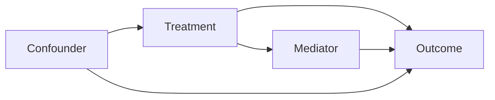

# Causal DAG Builder

A skill for constructing and validating Structural Causal Models (SCMs) and Directed Acyclic Graphs (DAGs) for research in AI, medical imaging, and epidemiology. The VIOS lab uses causal reasoning throughout — from study design to fairness analysis to disentanglement.

## When to invoke this skill

- Designing an observational study and needing to identify confounders
- Checking whether a causal effect is identifiable from available data
- Encoding domain knowledge about a medical or imaging system
- Analysing why a model exhibits a spurious correlation
- Performing mediation analysis (direct vs. indirect effects)
- Designing an intervention or experiment (what to randomise, what to stratify)

## Workflow

### 1. Elicit variables

Ask the user to list:
- **Exposure / treatment** (T): what you manipulate or care about
- **Outcome** (Y): what you are trying to explain or predict
- **Covariates**: everything else measured or known to exist
- **Unmeasured variables**: things known to exist but not in the dataset

For each variable, note: continuous or discrete, when it is measured, and whether it can be intervened on.

### 2. Elicit causal assumptions

For each pair of variables (A, B), ask: *"Does A directly cause B, or B cause A, or are they caused by a common third variable?"*

Work through:
- Temporal ordering (earlier events can cause later ones, not vice versa)
- Domain knowledge (prior literature, biology, physics)
- Data-generating process (how was the data collected?)

**Common patterns to watch for:**

| Pattern | Description | Implication |
|---------|-------------|-------------|
| Confounding | T ← C → Y | Adjust for C to estimate T→Y |
| Mediation | T → M → Y | Adjusting for M blocks the path |
| Collider | T → C ← Y | Do NOT adjust for C (opens spurious path) |
| Selection bias | Study entry depends on T and Y | Restricts population, biases estimates |
| Measurement error | Observed X* ≠ true X | Attenuates or distorts estimates |

### 3. Draw the DAG

Represent the DAG in Mermaid (rendered in GitBook and GitHub):



Or in text adjacency form for compact representation:
```
T → Y, C → T, C → Y, T → M, M → Y
```

State explicitly any **bidirected edges** (unobserved common causes):
```
T ↔ Y  (unobserved U causes both T and Y)
```

### 4. Check for cycles and consistency

- The graph must be acyclic — no variable can be its own ancestor.
- Check temporal consistency: does every arrow go from earlier to later in the study timeline?
- Flag any assumption that contradicts known domain knowledge.

### 5. Identification analysis

Given the DAG and the question P(Y | do(T)), determine identifiability:

**Step 1 — List all paths from T to Y** (both directed and backdoor).

**Step 2 — Apply the backdoor criterion**:
> A set Z satisfies the backdoor criterion relative to (T, Y) if:
> 1. No element of Z is a descendant of T.
> 2. Z blocks every backdoor path from T to Y.
> If such Z exists, P(Y | do(T)) = Σ_z P(Y | T, Z=z) P(Z=z).

**Step 3 — If backdoor fails, try frontdoor**:
> Applicable when T → M → Y and T ↔ Y (unobserved confounder), but M is unconfounded and blocks all directed paths from T to Y.

**Step 4 — If neither works, check for instrumental variables** (Z → T, Z ⊥ Y | T, no direct Z → Y path).

**Step 5 — If non-identified**, state this explicitly. Non-identification means no observational study can answer the causal question without additional assumptions — suggest what assumption would suffice (e.g., no unmeasured confounders, monotonicity, exclusion restriction).

### 6. Adjustment set

Given the valid adjustment set Z from Step 5:
- List variables to include in a regression or matching procedure.
- Flag variables that should NOT be adjusted (descendants of T, colliders).
- Note whether any required variables are unmeasured — if so, the estimate is biased.

### 7. Sensitivity analysis plan

For every unverifiable assumption:
- State the assumption formally.
- Describe how to vary it (e.g., E-value for unmeasured confounding, Rosenbaum bounds for matching).
- Report what magnitude of violation would reverse the conclusion.

### 8. Output

```
VARIABLES:
  Treatment (T): ...
  Outcome (Y): ...
  Measured covariates: ...
  Unmeasured / latent: ...

DAG (Mermaid):
  [diagram]

IDENTIFICATION:
  Target: P(Y | do(T))
  Backdoor set: {Z1, Z2} — valid? [yes/no/partial]
  Identification status: [identified / not identified / partially identified]
  Estimator: [regression adjustment / IPW / frontdoor / IV / bounds]

COLLIDERS TO AVOID CONDITIONING ON: [list]

SENSITIVITY:
  Assumption: [e.g., no unmeasured confounding]
  Sensitivity parameter: [E-value / Γ bound]
  Conclusion reverses at: [threshold]
```

## Anti-patterns

- **Do not** adjust for mediators when estimating the total effect — this blocks the causal path.
- **Do not** adjust for colliders — this opens spurious associations.
- **Do not** claim identification without checking all backdoor paths.
- **Do not** use "controlling for everything" as a strategy — more controls is not always better.
- **Do not** conflate association and causation in the output: use "is associated with" for observational claims and "causes" only for identified causal effects.

## VIOS-specific notes

- In medical imaging fairness analyses, protected attributes (age, sex, site) often act as confounders *and* colliders depending on the path — draw carefully before adjusting.
- In domain generalisation, data collection site is often a hidden common cause of both features and labels — model it explicitly.
- In segmentation studies, annotation quality and scanner protocol are frequently unmeasured confounders.

## See also

- `research-question-framing` for deciding whether the question is causal before building the DAG.
